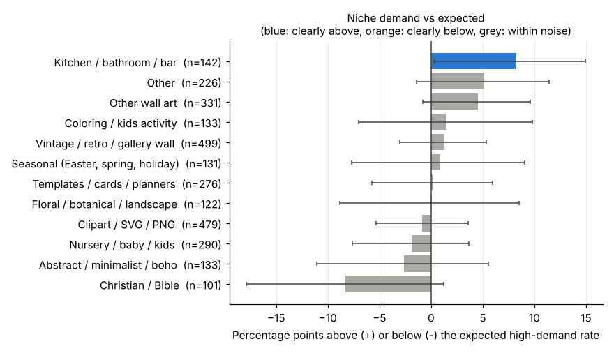
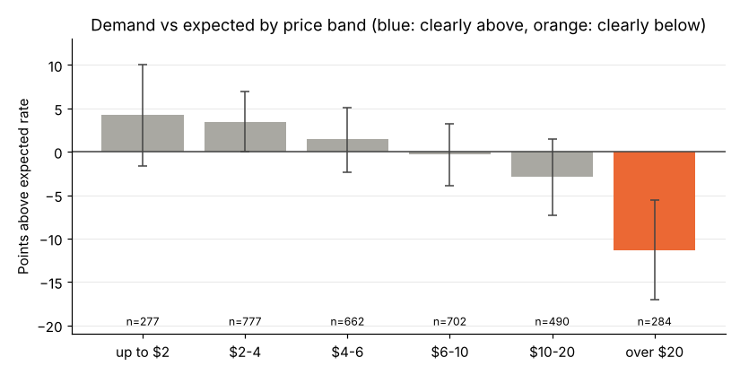

# Etsy marketplace analysis: which niches and price points are worth targeting?

A Python data-analysis portfolio project on Etsy's digital and printable wall-art market.

**Business question:** Which niches and price points are worth targeting, and what separates best-selling listings from the rest?

**Stack:** pandas, NumPy, Matplotlib, SQLite (via Python's `sqlite3`), Jupyter.

## Headline results

The analysis covers 3,192 best-seller listings that show a demand badge (cleaned from 4,632 raw scraped rows; 664 duplicates removed). A listing is "high-demand" if the badge shows 20+ carts or a recent purchase count (58.0% of the 3,192). Rates are compared with an expected rate for each listing's own scrape, with 95% intervals.

| Question | Result |
|---|---|
| Price | Listings over $20 are **11.3 points below expected** (95% CI -17.1 to -5.5, n=284). No band up to $20 differs clearly. |
| Niche | Kitchen / bathroom / bar wall art is the only niche above expected: +8.2 points (CI 0.3 to 14.9, n=142), a small sample. Most niches cannot be told apart. |
| What separates winners | Social proof. Median favourites are 1.50x (June) and 2.35x (July) higher for high-demand listings. Price, title length and bundle wording do not separate them. |
| Crowding | Clipart / SVG / PNG is 15.0% of listings at a $2.52 median price, with no demand premium (-0.9 points). |

**Recommendation:** test kitchen / bathroom / bar wall art at $4-10, keep prices at or below $20, avoid competing as a pure low-price clipart shop, and plan for early favourites and reviews. Full findings, caveats and the checks behind them are in the notebook.

A caution I built the analysis around: a first pass that counted listings with no demand badge as "not high-demand" made vintage wall art look +9.8 points above expected. That effect disappears (+1.3 points) when those listings are excluded, so the notebook does not claim a vintage edge. It shows both versions.




## What the notebook does

1. Loads two Octoparse scrapes and maps them to one schema.
2. Cleans them, with each step shown: duplicates (including the same listing in both files), missing values, price parsing (`"9.00+"` becomes 9.00 plus a variations flag), placeholder zeros from failed scrapes, and type fixes (text favourites and dates, review counts, demand badge text).
3. Explores demand, price, niches (keyword rules), and what separates high-demand listings, using Matplotlib, Wilson intervals and a NumPy bootstrap.
4. Answers the same questions in SQL on SQLite (window function, CTEs).
5. States findings and a recommendation, each backed by a number printed from the data.

## Data and privacy

The raw data was scraped and contains seller and listing identifiers, so it is **not in this repository** and `data/` is git-ignored. The notebook never prints titles or URLs, and drops identifier columns before analysis. `sample/anonymised_sample.csv` holds 300 rows with titles, URLs, shop names, listing IDs and exact counts removed, and `sample/schema.md` describes every column.

## Run it

```bash
pip install -r requirements.txt
```

Put your own scrapes in `data/` as `best_seller_jun2024.xlsx` and `best_seller_jul2024.xlsx` (column names are listed in `sample/schema.md`), then run `jupyter lab` and open `etsy_analysis.ipynb`. Without the raw files you can still read the executed notebook and explore `sample/anonymised_sample.csv`.

## Limitations

- "High-demand" is Etsy's live badge at scrape time, not sales or revenue.
- Two mid-2024 snapshots only, so seasonality and the current market are not covered.
- Niches come from title keywords, and about 10% of badged listings have no usable text.
- Favourites and reviews are associated with demand; the data cannot show which drives which.
- 776 listings with no badge could not be classified; they are excluded and tested separately.
